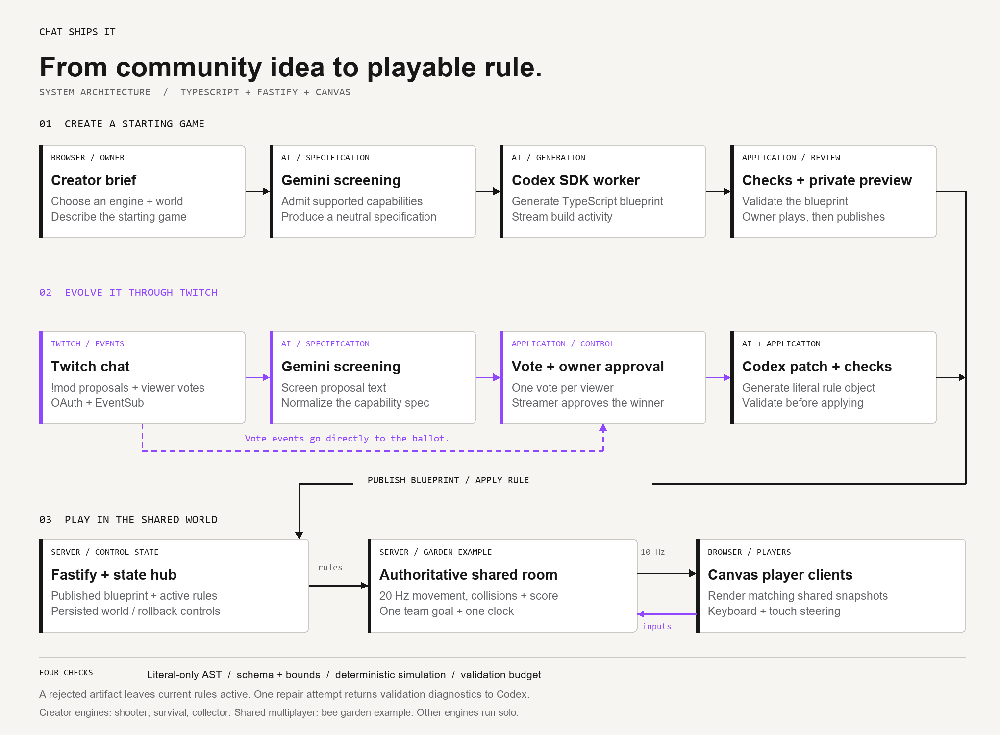

# Chat Ships It ↗

**Windows quick start (dependencies already installed):** run `./start.cmd` from this folder or double-click `start.cmd`. It starts the app directly with Node and does not require pnpm on your terminal's PATH. Keep the launcher window open while using the app.

**The community creates. The community plays. Codex ships.** A creator describes a starting game, tries a private preview, and publishes it. Choose shooter, survival, or collection across space, ocean, garden, and neon themes. The bee garden shown in the demo is one example a creator can make: viewers join one shared world and collect nectar toward the same goal. Twitch chat proposes changes and votes on a winner. Codex writes a TypeScript rule file. Four checks run before the shared garden adopts the patch. Rollback preserves the hive's progress.

**Try multiplayer without credentials:** double-click `try-multiplayer.cmd` after installing dependencies and building. Open http://127.0.0.1:4312/ for the owner desk and http://127.0.0.1:4312/?view=play in two or more tabs. Choose different guest names, join, then start the shared round from the owner desk. Use WASD, arrow keys, or touch to collect nectar. This launcher loads a reviewed garden in rehearsal mode and preserves a separate save. See [multiplayer controls and verification](docs/MULTIPLAYER.md).

## Run it

Requires Node 22+ (tested on Node 24.18.0), pnpm 11.25.0.

```sh
pnpm install
cp .env.example .env
pnpm build
pnpm start
```

On PowerShell use `Copy-Item .env.example .env` for the copy step. Open **http://localhost:4310**. Local installation here already has `.env` configured for the authenticated Codex executable; do not overwrite it to preserve that setting.

**Try it without credentials:** Load the rehearsal → Open the vote → click a finalist → Lock the vote → Load winning example. Rehearsal uses reviewed files and explicitly identifies every example.

**Try the real agent:** enable `ENABLE_CODEX=true` after `codex login`; Settings → Try real Codex with reviewed starter ideas → close Settings → vote → approve the build. This calls the actual Codex SDK, consumes plan usage, and streams real event summaries. Sample viewer names remain labeled as examples. No Gemini key is needed for reviewed starter ideas.

The game starts in a labeled autopilot attract mode. Click the canvas for manual play: **W / ↑** thrust, **A D / ← →** turn, **Space** shoot, **R** restart. On touch, hold to steer and shoot. Sound is optional.

## Create your channel's starting game

Click **Create a game**, choose shooter, dodger or collector, and describe your world. Codex generates a playable preview; publish it when ready, then let chat evolve its rules. Space, ocean, garden and neon worlds support ship, submarine, bee and orb avatars. See [the game creator guide](docs/GAME-CREATOR.md) for supported capabilities and controls.

## Live channel setup

[docs/SETUP.md](docs/SETUP.md) has exact credential links, callback URL, scope, server steps, OBS configuration, and deployment notes. Secrets belong in `.env` and `.local`, both ignored by Git. You do not need an OpenAI API key or a second Twitch account for the current read-only chat integration.

## Validate

```sh
pnpm check
pnpm test
pnpm build
# With the server running (resets the current local round):
pnpm smoke
# Optional real agent benchmark; consumes Codex usage:
pnpm exec tsx scripts/codex-smoke.ts
```

Tests cover hostile syntax, bounded schemas, all three example mods, vote changes, confidence vote locks, single repair, parallel build denial, cancellation, and rollback. The HTTP smoke checks WebSocket snapshots, cross-origin request denial, and an entire rehearsal round.

## How it works



- `apps/web`: Shared bee garden, solo game engines, responsive streamer desk, guest player view, OBS overlay.
- `apps/server`: Authoritative multiplayer simulation, Fastify HTTP + WebSocket hub, round state machine, Twitch EventSub OAuth/reconnect, Gemini proposal screening, Codex SDK worker.
- `packages/core`: strict mod schema, literal-only TypeScript AST parser, deterministic validation simulation, shared protocol.
- `scripts`: reproducible integration and real-agent smoke checks.

Generated mods are actual TypeScript files exporting a declarative rule object. The host parses the syntax and hands a validated manifest to reviewed engine code. Each manifest operates within the engine's defined capabilities. See [engineering notes](docs/ENGINEERING.md) for validation limits and verified vendor sources.

## Current limits

Live Twitch and Gemini have been exercised on @rapha18th. Multiplayer supports the garden collector with a bee avatar, up to 24 connected seats. Three simultaneous clients were verified. Other game engines run solo. Guest names are unverified. Confidence votes have no currency or prizes. Native Twitch Predictions/Polls, Channel Points, bot replies and raid transfer are deferred. Published games and current rules persist locally; shared round progress, partial votes and unpublished drafts reset on server restart. Remote viewers need a reachable hosted server; the demonstration currently runs locally. Docker deployment has not been verified on this machine.

The multiplayer demonstration used three explicitly labeled scripted players, real Twitch messages, one owner-account vote, and real Codex generation. Rainbow Nectar shipped in 23.751 seconds and passed four checks. Integration verification confirmed patch and rollback preserved the same round, three player IDs, team score, target, and remaining time. The film labels its scripted players and compressed build wait. See [demo verification](docs/DEMO.md). The [Devpost entry](https://devpost.com/software/chat-ships-it) is published and verified.
